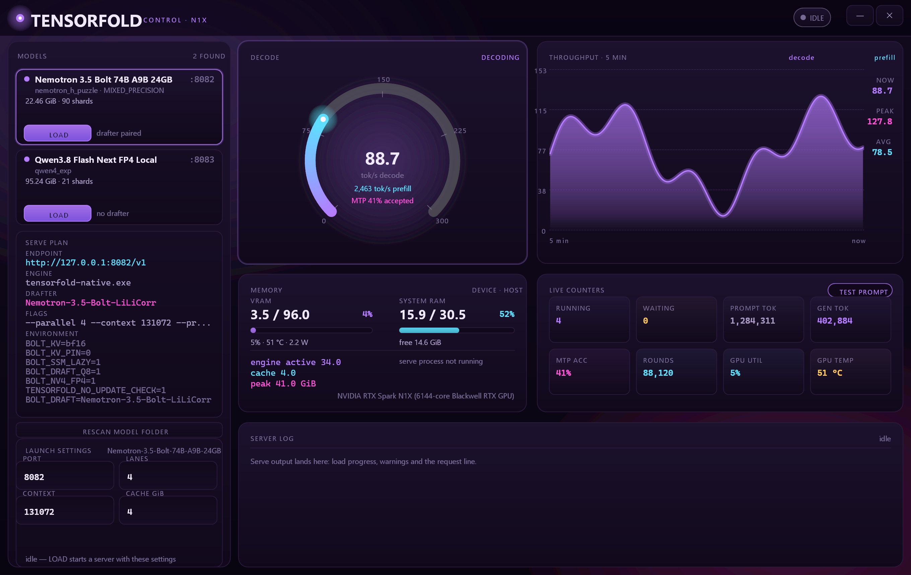

# TensorFold on Windows ARM64 (NVIDIA RTX Spark N1X)

This repository builds a **native Windows ARM64 TensorFold server and a Zig/Win32 model-control GUI**. It supports the model families implemented by the pinned [TensorFold fork](https://github.com/TheJeff/TensorFold), including Qwen-family checkpoints. The [Nemotron 3.5 Bolt recipe](https://github.com/MiaAI-Lab/Nemotron-3.5-Bolt-TensorFold-DGX-Spark) is an **optional additional backend**, not the purpose of the entire project. WSL and Docker are not required.

The TensorFold fork in the `tensorfold/` submodule already includes the Bolt build integration. **Do not apply the recipe's registration patch or copy its Zig sources again.** This repository provides the recipe's CUDA sources separately through `bolt-recipe/`.

> **Status:** Windows ARM64 / NVIDIA CUDA source-build project, not an installer. Text generation and structured output are supported by the pinned source. JPEG, WebP and video require additional native libraries and are not covered by this setup. The commands below are derived from the committed sources and batch files; a fresh checkout on another machine has not been end-to-end verified.

## Requirements

- Windows 11 ARM64 and an NVIDIA CUDA GPU. The supplied build flags target **SM 121** (NVIDIA GB10 / RTX Spark N1X); change `-Dsm` for a different supported GPU.
- A compatible NVIDIA driver. The CUDA toolkit is needed to **build**; a driver is also needed to **run**.
- Visual Studio 2022 Build Tools with **C++ build tools and ARM64 compiler/toolchain** (`vcvarsall.bat arm64`).
- CUDA Toolkit **13.4** with Windows ARM64 `nvcc.exe`; set `CUDA_PATH` to its installation directory.
- [Zig **0.17.0**, aarch64-windows](https://ziglang.org/download/0.17.0/) (not Zig 0.13/0.14 or an x64 binary).
- Git, with LF-preserving checkout for the recipe patches; model weights are downloaded separately.

The original environment used CUDA 13.4, Zig 0.17.0 and MSVC 2022. Other versions or GPU types are not validated here. Runtime memory requirements depend heavily on checkpoint, context and parallelism; the large examples below need substantial accessible CUDA memory.

## Checkout and directory layout

In PowerShell, choose **any writable parent directory**:

```powershell
git -c core.autocrlf=false clone --recurse-submodules https://github.com/TheJeff/tensorfold-win-arm64.git
cd tensorfold-win-arm64
git submodule status
```

If already cloned without submodules:

```powershell
git -c core.autocrlf=false submodule update --init --recursive
```

| Path | Purpose |
| --- | --- |
| `tensorfold/` | Pinned [TheJeff/TensorFold](https://github.com/TheJeff/TensorFold) fork, on the v1.2.6-based Windows ARM64 port |
| `bolt-recipe/` | Pinned Bolt recipe; `engine/` supplies the CUDA sources for `bolt.dll` |
| `xgrammar/` | Pinned xgrammar source used to build `tfgrammar.dll` |
| `gui/` | Native Zig/Win32 GUI; see [GUI README](gui/README.md) |
| `local-patches/` | Historical grammar loader patch, **not needed** with the pinned TensorFold fork |
| `models/` | Your downloaded checkpoints (ignored by Git; create this folder) |
| `tools/` | Local Zig toolchain (ignored by Git) |
| `tensorfold/zig-out-v126/`, `gui/zig-out/` | Build outputs (not committed). `tensorfold/zig-out/` holds the older 1.2.3 build if you keep one for A/B runs |

The commit IDs in the submodules, rather than a moving branch tip, determine which sources you build. Keep the submodules at their recorded commits when reproducing this setup.

## Build TensorFold

1. Extract the ARM64 Zig 0.17.0 archive into `tools/zig-aarch64-windows-0.17.0/`, so `tools/zig-aarch64-windows-0.17.0/zig.exe` exists.
2. Install the ARM64 MSVC components and CUDA 13.4.
3. Open **Command Prompt** at the repository root. Adapt the Visual Studio path and CUDA path to your installations:

```bat
call "C:\Program Files (x86)\Microsoft Visual Studio\2022\BuildTools\VC\Auxiliary\Build\vcvarsall.bat" arm64
set "CUDA_PATH=C:\Program Files\NVIDIA GPU Computing Toolkit\CUDA\v13.4"
set "PATH=%CUDA_PATH%\bin;%PATH%"
set "ROOT=%CD%"
set "ZIG=%ROOT%\tools\zig-aarch64-windows-0.17.0\zig.exe"

"%ZIG%" version
"%CUDA_PATH%\bin\nvcc.exe" --version
cd /d "%ROOT%\tensorfold"
"%ZIG%" build native install -Dsm=121 -Dstrip=true -Dnvcc="%CUDA_PATH%\bin\nvcc.exe" --prefix zig-out-v126
```

Expected output: `tensorfold/zig-out-v126/native/bin/tensorfold-native.exe` (the build installs with
`--prefix zig-out-v126`, so an older `zig-out` install is never overwritten).

**Optional Bolt backend:** If you intend to run Nemotron 3.5 Bolt, build its additional CUDA DLL from the pinned recipe sources with:

```bat
"%ZIG%" build native bolt install -Dsm=121 -Dstrip=true -Dnvcc="%CUDA_PATH%\bin\nvcc.exe" -Dbolt-src="%ROOT%\bolt-recipe\engine" --prefix zig-out-v126
```

This additionally produces `tensorfold/zig-out-v126/native/lib/bolt.dll`. You do **not** need it to serve Qwen or other families with their own CUDA backend.

The `build-bolt-126.bat` file invokes the optional Bolt build, **but currently hard-codes** the original developer's `C:\Projects\tensorfold-win-arm64`, Visual Studio and CUDA locations. Edit those paths before using it from another checkout, or use the portable commands above. The pinned fork has already integrated `patches/0002-register-bolt.patch`; applying it a second time is incorrect.

### Optional: structured output and tool calls

Build the grammar DLL from the `xgrammar/` submodule using the same configured Command Prompt:

```bat
cd /d "%ROOT%\tensorfold"
"%ZIG%" build grammar -Dxgrammar="%ROOT%\xgrammar"
```

Confirm `tensorfold/zig-out-v126/native/lib/tfgrammar.dll` exists. The pinned fork already recognizes the Windows DLL name. **Do not apply `local-patches/0001-grammar-dll-windows.patch` to this version.** The `build-grammar.bat` helper also contains an absolute checkout path; edit it if you prefer that helper.
A `tfgrammar.dll` built for the previous tag still serves structured output on 1.2.6 (verified with a
strict `json_schema` on Bolt), so an existing DLL can simply be copied into the new `lib/`.

## Models and serving

**This is not a Bolt-only model runner.** The native TensorFold executable can serve supported families beyond the two examples here. In particular, the pinned fork includes CUDA support for Qwen3.5/3.8 hybrid checkpoints and `qwen4_exp` (Qwen3.8 Flash-Next). Compatibility depends on a model's architecture and checkpoint format, not simply whether its name contains “Qwen.” Check the [fork's Windows documentation](https://github.com/TheJeff/TensorFold/blob/win-arm64/v1.2.6/docs/WINDOWS.md) and `tensorfold-native.exe info <checkpoint-directory>` when trying another checkpoint. Models not recognized by the pinned TensorFold source are not automatically supported by the GUI.

The scripts expect unpacked model snapshots in `models/` with the **directory names shown below**. Model files are not included in this repository. Download the checkpoints from the model publishers, respecting their model licenses, and retain the original model metadata and shard files.

- Bolt target: `models/Nemotron-3.5-Bolt-74B-A9B-24GB/` (model: `nvidia/NVIDIA-Nemotron-3.5-Bolt-74B-A9B-24GB`)
- Optional Bolt drafter: `models/Nemotron-3.5-Bolt-LiLiCorr/` (matching LiLiCorr drafter checkpoint)
- Qwen target: `models/Qwen3.8-Flash-Next-FP4-Local/` (model: `nvidia/Qwen3.8-Flash-Next-FP4-Local`)

The provided `serve-bolt.bat` and `serve-qwen38.bat` **also hard-code the original `C:\Projects\tensorfold-win-arm64` root**. Either change `set "ROOT=..."` in each script or launch directly from Command Prompt as follows.

### Nemotron 3.5 Bolt (optional)

From the repository root:

```bat
set "ROOT=%CD%"
set "BOLT_DRAFT=%ROOT%\models\Nemotron-3.5-Bolt-LiLiCorr"
set "BOLT_KV=bf16"
set "BOLT_KV_PIN=0"
set "BOLT_SSM_LAZY=1"
set "BOLT_DRAFT_Q8=1"
set "BOLT_NV4_FP4=1"
set "TENSORFOLD_NO_UPDATE_CHECK=1"
"%ROOT%\tensorfold\zig-out-v126\native\bin\tensorfold-native.exe" serve "%ROOT%\models\Nemotron-3.5-Bolt-74B-A9B-24GB" --name Nemotron-3.5-Bolt --host 127.0.0.1 --port 8082 --parallel 4 --context 131072 --prompt-cache-gib 4
```

If you do not have a matching drafter, remove `BOLT_DRAFT` from the environment and consult the pinned TensorFold/Bolt recipe for non-draft serving requirements. Do not point it at an unrelated checkpoint.

### Qwen3.8 Flash-Next

From a separate Command Prompt at the repository root:

```bat
set "ROOT=%CD%"
set "TENSORFOLD_MEMORY_RESERVE_GIB=4"
set "TF_FLASHNEXT_DRAFTS=6"
set "TF_FLASHNEXT_GATHER_READ=pread"
set "TENSORFOLD_NO_UPDATE_CHECK=1"
"%ROOT%\tensorfold\zig-out-v126\native\bin\tensorfold-native.exe" serve "%ROOT%\models\Qwen3.8-Flash-Next-FP4-Local" --name Qwen3.8-Flash-Next --host 127.0.0.1 --port 8083 --parallel 2 --context 262144 --prompt-cache-gib 4 --dashboard --metrics-open
```

Qwen3.8's `qwen4_exp` CUDA support is supplied by the pinned TensorFold fork; it does **not** use `bolt.dll`. This large checkpoint and the example 262k context require a suitably large device memory budget. Reduce `--parallel`/`--context` if necessary; the example is not a universal default. The Windows CUDA path has been documented as using bf16 KV for this model, not fp8 KV.

### Smoke test

With a server running, use PowerShell in another terminal:

```powershell
Invoke-RestMethod http://127.0.0.1:8082/v1/models
$body = @{
  model = "Nemotron-3.5-Bolt"
  messages = @(@{ role = "user"; content = "Say hello in one sentence." })
  max_tokens = 64
} | ConvertTo-Json -Depth 5
Invoke-RestMethod -Method Post -Uri http://127.0.0.1:8082/v1/chat/completions -ContentType "application/json" -Body $body
```

Use port `8083` and model name `Qwen3.8-Flash-Next` for the Qwen launcher. A successful `/v1/models` response confirms HTTP availability; generation confirms the model has loaded and can run. Structured `response_format` and required tool calls additionally need `tfgrammar.dll`.

## Native control GUI

```bat
gui\build-gui.bat
gui\zig-out\bin\tensorfold-gui.exe
```

The GUI build script locates Zig relative to its own directory and is not tied to `C:\Projects`. It scans checkpoint directories in `models/` and identifies models using their metadata; it is **not limited to Bolt or the supplied Qwen launch script**. It creates local `gui/models.json` profiles, launches the native server, and can attach to an existing server. The default launch profiles explicitly cover Bolt and `qwen4_exp`; verify and adjust settings for other architectures. See [gui/README.md](gui/README.md) for CLI options, screenshots, port behavior and limitations. It is a **server control/monitoring interface**, not a chat UI.



The GUI's header shows the engine version it is running: a `TF x.y.z` chip beside `CONTROL · N1X`,
probed from `<exe> --version` while idle, replaced by the server's own `/health` value once one is
serving or attached, and shown in amber as `TF 1.2.3 · built 1.2.6` when an older server is running
than the build on disk.

## Engine 1.2.6 (the default install)

Upstream tagged **v1.2.6** on 2026-11-10, 1406 commits past the v1.2.3 base this guide used to
pin. The fork re-ports it on branch `win-arm64/v1.2.6`; `build-bolt-126.bat` builds it to
`tensorfold/zig-out-v126`, and `serve-bolt.bat`, `serve-qwen38.bat` and the GUI launch that install.

Measured against 1.2.3 on Qwen3.8 Flash Next FP4 (median of 2-4 alternating runs, warm page cache,
unique prompt per sample, 384-token replies): cold prefill **level** (2K +6%, 8K -1%, 32K +1%),
single-stream decode **level**, 8 concurrent streams **+3.7%** aggregate (197.1 -> 204.3 tok/s), and
replies bit-identical. Bolt loads in ~25 s and answers through `libbolt.dll` as before.

Two things to know before benchmarking this model yourself:

- **Never A/B Flash Next on a cold page cache.** It walks its n-gram embedding tables through the
  page cache, so the first runs after a build read 20-35% slower and fake a large prefill win.
  Discard the first pair and alternate builds.
- Absolute tok/s depends on MTP acceptance (94-99% on predictable prompts, ~58% on a short answer),
  so trust A/B deltas over any single throughput figure.

Method, per-run JSON and the full claim-by-claim assessment of 1.2.4-1.2.6: `BENCH-1.2.6.md`,
`bench/`, and `UPSTREAM-1.2.6.md`.

## Troubleshooting and scope

- **A checkpoint appears but will not serve:** GUI discovery is not proof of TensorFold CUDA support for that architecture or weight format; inspect the model with `tensorfold-native.exe info` and consult the pinned fork's supported families.
- **`zig` or `nvcc` not found:** confirm the ARM64 Zig archive location, `CUDA_PATH`, and that the MSVC ARM64 environment was activated in the **same Command Prompt** used for building.
- **Patch rejects / CRLF errors:** clone with `git -c core.autocrlf=false`; do not manually reapply the Bolt or grammar patches to the pinned fork.
- **Missing `bolt.dll` or `tfgrammar.dll`:** check the `zig-out-v126/native/lib/` build output. Grammar is optional for ordinary text generation, but required for grammar-constrained requests.
- **Out-of-memory / load failure:** check available CUDA device memory and lower context or parallelism. Model weight sizes alone do not describe peak loading/runtime requirements.
- **GUI cannot find models:** create `models/` in the repository root and include each checkpoint's `config.json` and weight files.
- **Images/video:** native Windows ARM64 JPEG, WebP and FFmpeg-based video dependencies are not provided. See [NEXT-STEPS.md](NEXT-STEPS.md) for what remains to be ported.

The benchmark figures and machine-specific binary hashes from the original development setup are **not reproducibility guarantees**. For performance comparisons, record the exact submodule SHAs, GPU/driver, memory budget, model revisions, build flags, context, concurrency and measurement method.

## Related projects

- [TensorFold upstream](https://github.com/ashhart/TensorFold) and [Windows build documentation](https://github.com/TheJeff/TensorFold/blob/win-arm64/v1.2.6/docs/WINDOWS.md)
- [Windows ARM64 TensorFold fork](https://github.com/TheJeff/TensorFold) (see its `FORK.md` for branch history)
- [Nemotron 3.5 Bolt recipe](https://github.com/MiaAI-Lab/Nemotron-3.5-Bolt-TensorFold-DGX-Spark) (see `docs/windows.md`)
