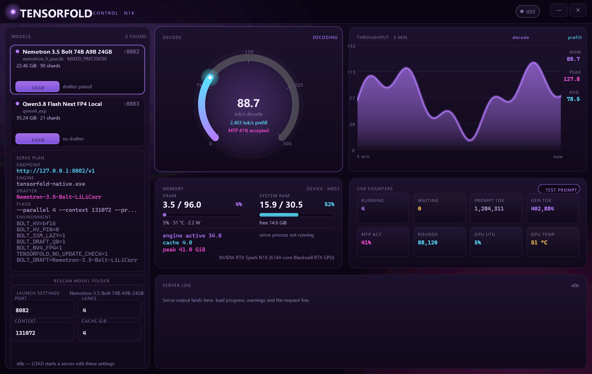

# TensorFold on Windows ARM64 — a local LLM stack for RTX Spark (N1X) laptops

**Native TensorFold plus a native control GUI, for Windows 11 ARM64 laptops with NVIDIA RTX Spark / N1X**
(GB10-class Blackwell, `sm_121`, 96 GiB GPU framebuffer). Build once, then load models from a dashboard
or a double-clickable `.bat` and talk to an OpenAI-compatible `/v1` API on localhost.
**No WSL, no Docker, no Linux recipe to port.**

**Built on other people's work, credited up front:** the engine is
[TensorFold](https://github.com/ashhart/TensorFold) by **Ash Hart and the TensorFold contributors** —
this repo is a Windows ARM64 port of their Zig engine, and upstream's Apache-2.0 license and NOTICE
travel with the `tensorfold/` submodule. The Flash-Next features shipped here (quantised vision
towers, fp8 KV, 16k image budgets, the MXFP8 prompt tile, video wiring) are
**[MiaAI-Lab](https://github.com/MiaAI-Lab)**'s patches from their
[single-DGX-Spark recipe](https://github.com/MiaAI-Lab/Qwen3.8-Flash-Next-Single-DGX-Spark-TensorFold),
applied unmodified under MIT with the license kept beside them (`local-patches/mia-v1.2.7/`); the
Bolt backend comes from their
[Nemotron 3.5 Bolt recipe](https://github.com/MiaAI-Lab/Nemotron-3.5-Bolt-TensorFold-DGX-Spark).
What this repo adds is the port itself: the Windows ARM64 build, the native GUI, the locally built
decoders, and the gate and benchmarks that verify them.

This is the author's daily-driver inference stack on that hardware, and the reason this repo exists.
NVIDIA's DGX Spark recipes — TensorFold's and llama.cpp's alike — assume Linux/Docker; on a Windows
laptop that road goes through WSL2 with unified-memory budget bugs and 9p weight-loading traps.
Here every piece (engine, Bolt backend, grammar DLL, JPEG/WebP decoders, GUI) is a native ARM64
Windows binary, and the whole path is verified by a gate you can re-run. Day-to-day it simply works
better on this laptop than the llama.cpp-under-NVIDIA's-recipes route: one stack, a real control
surface, 262k contexts, tool calls and images included.

> **Status:** source-build project, not an installer. Text generation, structured output/tool calls,
> JPEG/WebP images and **PDF input** are measured working on the reference machine (engine 1.2.7);
> FFmpeg video is not built yet. A fresh checkout on another machine has not been end-to-end
> verified, and the numbers below are one-machine receipts, not reproducibility guarantees.

## What you get

- **A control surface, not just a server.** The [GUI](gui/README.md) discovers checkpoints under
  `models/`, loads and unloads them (including servers it did not start), and shows live decode/prefill
  tok/s, MTP acceptance, KV occupancy, NVML framebuffer and host RAM, plus a chip naming the engine
  version it is actually talking to. The launch command is data (`gui/serve.json`), not compiled-in
  Zig, and each model carries its own profile. Four skins; headless `--shot`/`--plan` dev aids.
- **Long context on one GPU.** Qwen3.8 Flash-Next FP4 serves a **262,144-token** window at 72.7 GiB
  resident of the 96 GiB framebuffer. Opt-in fp8 KV (MiaAI-Lab patch 0003) admits **5 concurrent
  full 262k streams** where bf16 caps at 3; a 255,002-token needle was found on both. Bolt 74B-A9B
  held **16 streams at 262k in 34.7 GB** of the framebuffer.
- **Speculative decoding and prompt caching.** MTP drafts on both families; a 4 GiB prompt cache in
  the default profiles.
- **Structured output and tool calls.** `tfgrammar.dll` built from the pinned xgrammar; strict
  `json_schema` and `tool_choice: "required"` verified on Bolt.
- **Images that are tested, not assumed.** `turbojpeg.dll` 3.1.4.1 and `libwebpdecoder.dll` 1.6.0 are
  built here and decode **pixel-exact against Pillow**. On 1.2.7 the stock FP4 checkpoint's quantised
  vision tower decodes to bf16 at load (MiaAI-Lab patch 0001), so `--vision` works without surgery;
  `scripts/splice-vision-tower.py` remains the route on older builds. The gate asserts the tower
  actually read the pixels — 5/5 ground-truth facts, 560 vs 26 prompt tokens, broken inputs refused
  with HTTP 400.
- **PDF input.** `pdfium.dll` from the pypdfium2 win_arm64 wheel renders pages in-process on Windows
  (`--vision --vision-pdf`); the gate reads a printed word back from a rendered page and refuses a
  truncated PDF with 400.
- **Honest A/B benchmarks.** `bench/` drives unique nonce prompts (the prefix cache cannot fake a
  result), alternates builds on a warm page cache and keeps per-run JSON. See `docs/receipts/BENCH-1.2.7.md`
  (and `docs/receipts/BENCH-1.2.6.md` for the previous port).

llama.cpp remains a good engine — its multi-slot serving is strong — so the claim here is about the
whole Windows-laptop experience, not a universal throughput win; no comparative llama.cpp numbers are
published in this repo.



## Quickstart

### Requirements

- Windows 11 ARM64 and an NVIDIA CUDA GPU. The supplied build flags target **SM 121** (NVIDIA GB10 /
  RTX Spark N1X); change `-Dsm` for a different supported GPU. Only `sm_121` is validated here.
- A compatible NVIDIA driver. The CUDA toolkit is needed to **build**; a driver is also needed to **run**.
- Visual Studio 2022 Build Tools with **C++ build tools and the ARM64 compiler/toolchain**
  (`vcvarsall.bat arm64`). CMake and Ninja ship inside it — the decoder builds need nothing else.
- CUDA Toolkit **13.4** with Windows ARM64 `nvcc.exe`; set `CUDA_PATH` to its installation directory.
- [Zig **0.17.0**, aarch64-windows](https://ziglang.org/download/0.17.0/) (not 0.13/0.14, not an x64 binary).
- Git. Model weights are downloaded separately, under `models/`.
- For the build gate's Decode/Vision tiers only: a Python with **numpy and Pillow** (`-Python`
  parameter; the gate invokes it with `-I` so ambient `PYTHONPATH` cannot hijack the import).

The reference environment is CUDA 13.4, Zig 0.17.0 and MSVC 2022. Other versions or GPU types are not
validated. Runtime memory depends heavily on checkpoint, context and parallelism; the large examples
need substantial accessible CUDA memory.

### Checkout and layout

```powershell
git clone --recurse-submodules https://github.com/TheJeff/tensorfold-win-arm64.git
cd tensorfold-win-arm64
git submodule status
```

Already cloned without submodules: `git submodule update --init --recursive`.
`.gitattributes` keeps the recipe patches LF and the batch files CRLF regardless of your
`core.autocrlf`, so the old `-c core.autocrlf=false` workaround is no longer load-bearing.

| Path | Purpose |
| --- | --- |
| `tensorfold/` | Pinned [TheJeff/TensorFold](https://github.com/TheJeff/TensorFold) fork, on the v1.2.7-based Windows ARM64 port (`win-arm64/v1.2.7`, upstream v1.2.7 + MiaAI-Lab patches 0001-0005) |
| `bolt-recipe/` | Pinned Bolt recipe; `engine/` supplies the CUDA sources for `bolt.dll` |
| `xgrammar/` | Pinned xgrammar source used to build `tfgrammar.dll` |
| `gui/` | Native Zig/Win32 GUI; see [GUI README](gui/README.md) |
| `tests/engine/` | Build gate: `verify-engine.ps1`, Pillow pixel-parity, ground-truth vision probe |
| `scripts/` | `splice-vision-tower.py` (bf16 vision tower), `build/` (engine + decoder build wrappers), `port-127/` (one-shot 1.2.7 port/bench drivers) |
| `docs/` | `NEXT-STEPS.md` roadmap and `receipts/` — the bench and upstream-port receipts |
| `bench/` | A/B benchmark harness and per-run JSON |
| `local-patches/` | Historical grammar patch (**not needed** with the pinned fork) + `mia-v1.2.7/`, the applied MiaAI-Lab patch stack (MIT) |
| `models/` | Your downloaded checkpoints (ignored by Git; create this folder) |
| `tools/` | Local Zig toolchain (ignored by Git) |
| `tensorfold/zig-out-v127/`, `gui/zig-out/` | Build outputs (not committed). Older installs (`zig-out-v126/`, `zig-out/`) are kept for A/B runs and rollback |

The submodule commit IDs, not a moving branch tip, determine what you build. Keep them at their
recorded commits when reproducing this setup.

### Build the engine

1. Extract the ARM64 Zig 0.17.0 archive into `tools/zig-aarch64-windows-0.17.0/` so
   `tools/zig-aarch64-windows-0.17.0/zig.exe` exists.
2. Install the ARM64 MSVC components and CUDA 13.4.
3. Open **Command Prompt** at the repository root (adapt the VS and CUDA paths to your installs):

```bat
call "C:\Program Files (x86)\Microsoft Visual Studio\2022\BuildTools\VC\Auxiliary\Build\vcvarsall.bat" arm64
set "CUDA_PATH=C:\Program Files\NVIDIA GPU Computing Toolkit\CUDA\v13.4"
set "PATH=%CUDA_PATH%\bin;%PATH%"
set "ROOT=%CD%"
set "ZIG=%ROOT%\tools\zig-aarch64-windows-0.17.0\zig.exe"

"%ZIG%" version
"%CUDA_PATH%\bin\nvcc.exe" --version
cd /d "%ROOT%\tensorfold"
"%ZIG%" build native install -Dsm=121 -Dstrip=true -Dnvcc="%CUDA_PATH%\bin\nvcc.exe" --prefix zig-out-v127
```

Expected output: `tensorfold/zig-out-v127/native/bin/tensorfold-native.exe`. The `--prefix` keeps an
older `zig-out` install intact for A/B runs. `scripts\build\build-bolt-127.bat` wraps this but **hard-codes the
original developer's paths** — edit it, or use the portable commands above.

### Optional DLLs

```bat
rem Bolt backend (only for Nemotron 3.5 Bolt; Qwen families do not use it):
"%ZIG%" build native bolt install -Dsm=121 -Dstrip=true -Dnvcc="%CUDA_PATH%\bin\nvcc.exe" -Dbolt-src="%ROOT%\bolt-recipe\engine" --prefix zig-out-v127

rem Structured output / tool calls:
"%ZIG%" build grammar -Dxgrammar="%ROOT%\xgrammar" --prefix zig-out-v127

rem JPEG and WebP input decoding (run from the repo root; they find VS's own CMake/Ninja):
scripts\build\build-jpeg.bat
scripts\build\build-webp.bat
```

- The fork already integrates the Bolt registration patch and recognises the Windows grammar DLL
  name. **Do not re-apply `patches/0002` or `local-patches/0001-grammar-dll-windows.patch`.**
- A `tfgrammar.dll` built for the previous tag still serves structured output on 1.2.7 (verified with
  a strict `json_schema` on Bolt), so an existing DLL can simply be copied into the new `lib/`.
- The decoder builds pin **libjpeg-turbo 3.1.4.1** and **libwebp 1.6.0** exactly — the engine refuses
  other versions because its pixels are qualified against Pillow's. Both DLLs are self-contained
  (static CRT, import only KERNEL32). WebP additionally needs `TENSORFOLD_LIBWEBP` pointing at
  `libwebpdecoder.dll` (the engine has no Windows name for it); the GUI profile sets that for you.
- `scripts\build\build-grammar.bat` also contains an absolute checkout path; edit it if you prefer that helper.

### Serve

**From the GUI (the front door):**

```bat
gui\build-gui.bat
gui\zig-out\bin\tensorfold-gui.exe
```

It scans `models/`, writes per-model profiles to `gui/models.json`, and LOAD/UNLOAD buttons do the
rest. `gui\build-gui.bat` locates Zig relative to itself and is not tied to any checkout path. The
GUI is a **server control/monitoring interface**, not a chat UI. See [gui/README.md](gui/README.md)
for CLI options (`--attach`, `--load`, `--plan`, `--shot`, skins), port behavior and limits.

**From the launchers:** `serve-bolt.bat` (port 8082) and `serve-qwen38.bat` (port 8083) — both
**hard-code the original `C:\Projects\tensorfold-win-arm64` root**; change `set "ROOT=..."` or serve
directly:

```bat
rem Nemotron 3.5 Bolt (optional backend):
set "ROOT=%CD%"
set "BOLT_DRAFT=%ROOT%\models\Nemotron-3.5-Bolt-LiLiCorr"
set "BOLT_KV=bf16"
set "BOLT_KV_PIN=0"
set "BOLT_SSM_LAZY=1"
set "BOLT_DRAFT_Q8=1"
set "BOLT_NV4_FP4=1"
set "TENSORFOLD_NO_UPDATE_CHECK=1"
"%ROOT%\tensorfold\zig-out-v127\native\bin\tensorfold-native.exe" serve "%ROOT%\models\Nemotron-3.5-Bolt-74B-A9B-24GB" --name Nemotron-3.5-Bolt --host 127.0.0.1 --port 8082 --parallel 4 --context 131072 --prompt-cache-gib 4
```

Without a matching drafter, remove `BOLT_DRAFT` and consult the recipe for non-draft serving; do not
point it at an unrelated checkpoint.

```bat
rem Qwen3.8 Flash-Next (native qwen4_exp CUDA support in the fork; no bolt.dll):
set "ROOT=%CD%"
set "TENSORFOLD_MEMORY_RESERVE_GIB=4"
set "TF_FLASHNEXT_DRAFTS=6"
set "TF_FLASHNEXT_GATHER_READ=pread"
set "TENSORFOLD_NO_UPDATE_CHECK=1"
"%ROOT%\tensorfold\zig-out-v127\native\bin\tensorfold-native.exe" serve "%ROOT%\models\Qwen3.8-Flash-Next-FP4-Local" --name Qwen3.8-Flash-Next --host 127.0.0.1 --port 8083 --parallel 2 --context 262144 --prompt-cache-gib 4 --dashboard --metrics-open
```

The 262k example needs a suitably large device-memory budget; reduce `--parallel`/`--context`
otherwise. KV defaults to **bf16**; `--kv-cache fp8` (MiaAI-Lab 0003, opt-in, lossy) admits 5 full
262k streams instead of 3. For images add `--vision` — the stock checkpoint works on 1.2.7 (0001);
for PDFs add `--vision-pdf` with `pdfium.dll` in `lib/`.

### Smoke test

```powershell
Invoke-RestMethod http://127.0.0.1:8082/v1/models
$body = @{
  model = "Nemotron-3.5-Bolt"
  messages = @(@{ role = "user"; content = "Say hello in one sentence." })
  max_tokens = 64
} | ConvertTo-Json -Depth 5
Invoke-RestMethod -Method Post -Uri http://127.0.0.1:8082/v1/chat/completions -ContentType "application/json" -Body $body
```

Use port 8083 / `Qwen3.8-Flash-Next` for the Qwen launcher (the GUI's local profiles may use other
ports — they live in `gui/models.json`). `/v1/models` proves HTTP availability; generation proves the
model loaded. Structured `response_format` and required tool calls additionally need `tfgrammar.dll`.

## Models

**This is not a Bolt-only model runner.** The pinned fork implements CUDA support for Qwen3.5/3.8
hybrids and `qwen4_exp` (Qwen3.8 Flash-Next) among others; compatibility depends on architecture and
checkpoint format, not on a name containing "Qwen". Check
`tensorfold-native.exe info <checkpoint-dir>` and the
[fork's Windows documentation](https://github.com/TheJeff/TensorFold/blob/win-arm64/v1.2.7/docs/WINDOWS.md)
before trying another checkpoint. GUI discovery is not proof of engine support.

Download snapshots into `models/` under these directory names (weights are not in this repo; respect
the publishers' licenses and keep original metadata and shards):

- `models/Nemotron-3.5-Bolt-74B-A9B-24GB/` — `nvidia/NVIDIA-Nemotron-3.5-Bolt-74B-A9B-24GB`
- `models/Nemotron-3.5-Bolt-LiLiCorr/` — the matching Bolt drafter (optional)
- `models/Qwen3.8-Flash-Next-FP4-Local/` — `nvidia/Qwen3.8-Flash-Next-FP4-Local`

**Images:** the FP4 export quantised its vision tower. On **1.2.7 + mia 0001** the loader decodes
MXFP8/NVFP4 towers to bf16 at load, so `--vision` on the stock checkpoint just works (77.65 GiB,
55.9 s measured). On older builds the splice grafts the bf16 tower from
`nvidia/Qwen3.8-Flash-Next-NVFP4-QAD` (whose own export left the tower alone) without touching the
original: everything else is hardlinked, the rewritten shard's non-visual bytes are identical by
construction, and a 15-check verifier ends in `SPLICE OK`.

```bat
python scripts\splice-vision-tower.py
rem -> models\Qwen3.8-Flash-Next-FP4-Local-vision, serve it with --vision
```

`--vision-image-tokens` caps at **16,384** per request on 1.2.7 + mia 0002 (each image still keeps
4,096 at most); older builds abort the load above 4,096. Full story and measured results:
[docs/NEXT-STEPS.md](docs/NEXT-STEPS.md), "How to make images work here", and [docs/receipts/MIA-V127-REVIEW.md](docs/receipts/MIA-V127-REVIEW.md).

## The build gate

`tests/engine/verify-engine.ps1` checks a **candidate** build before you promote it over the engine
you serve; it never touches a running server. Exit code is the number of FAILs. Four tiers,
cheapest first:

| Tier | Cost | What it proves |
| --- | --- | --- |
| `Probes` | ~2 s, no GPU | binary answers, `capabilities --json` parses, chip is `sm_121`, cuda present, optional libraries where expected, every serve flag the launchers use still exists |
| `Decode` | ~5 s, no GPU | the built decoders reproduce Pillow's pixels **byte for byte** (ctypes, same call sequences the engine uses) |
| `Vision` | ~20 s | ground-truth reading against an already-running server (`-Attach`): five facts that exist only in the pixels, image-vs-text token delta, both decoders fed raw bytes, broken input refused with 400 |
| `Serve` | minutes, GPU | boots a model and proves images survive the tower into a reply, plus the negative cases; runs the Vision probe at the end |

```powershell
.\tests\engine\verify-engine.ps1                 # Probes + Decode on the installed engine
.\tests\engine\verify-engine.ps1 -Tier Serve     # full gate (defaults to the spliced vision tree)
```

**Run the Serve tier on AC power.** The gate holds the system awake while it runs: an idle-timeout
Modern Standby entry mid-load bugchecks this box (0x19C, the NVIDIA display-power watchdog —
observed 2026-11-18). It also reads `gui/models.json` and applies that model's env before probing,
so it tests the environment the GUI actually creates. Upstream's own loader tests run here too:
`zig build test-codec-diagnostics-host --summary all` from `tensorfold/` (12/12 on Windows ARM64).
On installs shipping `pdfium.dll`, the Serve tier also renders a PDF fixture and reads its printed
word back, and refuses a truncated PDF.

## Engine 1.2.7 and the receipts

Upstream tagged **v1.2.7** (`93a2e93e`); the fork re-ports onto it on `win-arm64/v1.2.7` with
**zero conflicts** and carries MiaAI-Lab's five Flash-Next patches (quantised vision towers, 16k
image budgets, opt-in fp8 KV, the MXFP8 prompt tile, video wiring). `scripts\build\build-bolt-127.bat` builds it
to `zig-out-v127`; the launchers and GUI use that install, with `zig-out-v126` kept hot for
rollback. Measured against 1.2.6 on Flash Next FP4 (alternating runs, unique prompts; a
power-capped, cold-cache day — deltas valid, absolutes not comparable to the 1.2.6 receipt):
prefill **+1-5%**, single-stream decode **level**, 8 concurrent streams **+6.4%** at 384-token
replies (152.5 → 162.3 tok/s), replies **bit-identical**. fp8 KV admits **5 full 262k streams**
(bf16: 3); a 255,002-token needle is found on both. PDF input and the stock vision tower are
gate-proven. Bolt loads ~22 s and passes strict `json_schema` through `libbolt.dll` +
`tfgrammar.dll`. Method and per-run JSON: `docs/receipts/BENCH-1.2.7.md`, `bench/`, `docs/receipts/UPSTREAM-1.2.7.md`,
`docs/receipts/MIA-V127-REVIEW.md`.

The previous port (v1.2.3 → **v1.2.6**, 2026-11-11, warm cache): prefill level, single-stream
decode level, 8 streams +3.7% (197.1 → 204.3 tok/s), replies bit-identical — `docs/receipts/BENCH-1.2.6.md`,
`docs/receipts/UPSTREAM-1.2.6.md`.

Reference-machine receipts (one N1X laptop; **not** guarantees):

| Workload | Result |
| --- | --- |
| Qwen3.8 Flash-Next FP4, 262k window | 51-56 s load → 72.76 GiB weights (2026-11-19, power-capped day); 41 s / 72.7 GiB on the warm 1.2.6 day; ~30 tok/s single-stream prose (warm day) |
| fp8 KV (mia 0003, opt-in) | 5 full 262k streams admitted (4.72 GiB each vs bf16's 7.86, which caps at 3); 255,002-token needle found on bf16 and fp8 |
| PDF input (2026-11-19 gate) | page rendered in-process, printed word read back (`PDFIUM-OK`); truncated PDF refused 400 |
| Bolt 74B-A9B + LiLiCorr (TF 1.1.6 receipt, 2026-11-01, commit `dab7cd6`) | 26 s load; 88.7 tok/s prose / 145.4 code solo; 240.9 aggregate @4 streams, 446.2 @16; 16×262k held 34.7 GB |
| Images (2026-11-19 gate, 1.2.7) | 0 failed, 0 warned: pixel parity 8/8, 5/5 ground-truth facts, 560 vs 26 prompt tokens, 6 refusals at HTTP 400; stock unspliced tower loads with `--vision` |

Two things to know before benchmarking Flash Next yourself:

- **Never A/B on a cold page cache.** It walks its n-gram embedding tables through the page cache;
  first runs after a build read 20-35% slower and fake a large prefill win. Discard the first pair,
  alternate builds, score medians.
- Absolute tok/s depends on MTP acceptance (94-99% on predictable prompts, ~58% on a short answer),
  so trust A/B deltas over any single throughput figure.

## Troubleshooting and scope

- **A checkpoint appears but will not serve:** GUI discovery is not proof of CUDA support for that
  architecture/format; inspect it with `tensorfold-native.exe info` and the fork's family list.
- **`zig` or `nvcc` not found:** confirm the ARM64 Zig location, `CUDA_PATH`, and that the MSVC ARM64
  environment was activated in the **same Command Prompt** used for building.
- **Patch rejects / CRLF errors:** `.gitattributes` now handles this; do not manually reapply the
  Bolt or grammar patches to the pinned fork.
- **Missing `bolt.dll` / `tfgrammar.dll`:** check `zig-out-v127/native/lib/`. Grammar is optional for
  plain text, required for grammar-constrained requests.
- **Out-of-memory / load failure:** check free CUDA memory and lower context/parallelism; weight
  size alone does not describe peak load/runtime requirements. `info`'s "memory floor" includes a
  runtime margin and can exceed the framebuffer while the loader still packs the model — try the
  load, and budget headroom with `TENSORFOLD_MEMORY_RESERVE_GIB` (2-4 GiB suits this box).
- **`BadImageLimits` at load:** `--vision-image-tokens` above the cap — 16,384 on 1.2.7 + mia 0002,
  4,096 on older builds; lower it.
- **GUI cannot find models:** create `models/` with each checkpoint's `config.json` and weight files.
- **Images/PDF/video:** JPEG/WebP work as described above (`--vision`, `TENSORFOLD_LIBWEBP`); PDF
  works on 1.2.7 (`--vision-pdf`, `pdfium.dll`). FFmpeg video is still not provided — see
  [docs/NEXT-STEPS.md](docs/NEXT-STEPS.md).
- **`serve --help` omits the vision flags** while the CLI parses them; trust
  `capabilities --json`'s `serve.flags`, not the help text.

For performance comparisons, record the exact submodule SHAs, GPU/driver, memory budget, model
revisions, build flags, context, concurrency and measurement method.

## What's still missing

- **Video** (`tfvideo.dll`): FFmpeg 9.0.2 for winarm64 exists only as BtbN's *shared* zip; two routes
  (import-lib link vs faithful static source build) are costed in NEXT-STEPS item 3. The engine
  wiring (mia 0005) is already in the branch, inert until the DLL exists.
- **EXL3** checkpoints have no Zig loader; that format lives in the Python CUDA engine only.
- Upstream ships **no windows-arm64 prebuilt** (linux x86_64/aarch64 + macos only). This fork is the
  reproduction of the `aarch64-windows`/`sm_121` receipt that upstream's `docs/WINDOWS.md` calls a
  PR report "not reproduced on the maintained tree".

## Related projects

- [TensorFold upstream](https://github.com/ashhart/TensorFold) and the
  [Windows build documentation](https://github.com/TheJeff/TensorFold/blob/win-arm64/v1.2.7/docs/WINDOWS.md)
- [Windows ARM64 TensorFold fork](https://github.com/TheJeff/TensorFold) (see its `FORK.md` for branch history)
- [Nemotron 3.5 Bolt recipe](https://github.com/MiaAI-Lab/Nemotron-3.5-Bolt-TensorFold-DGX-Spark) (see `docs/windows.md`)