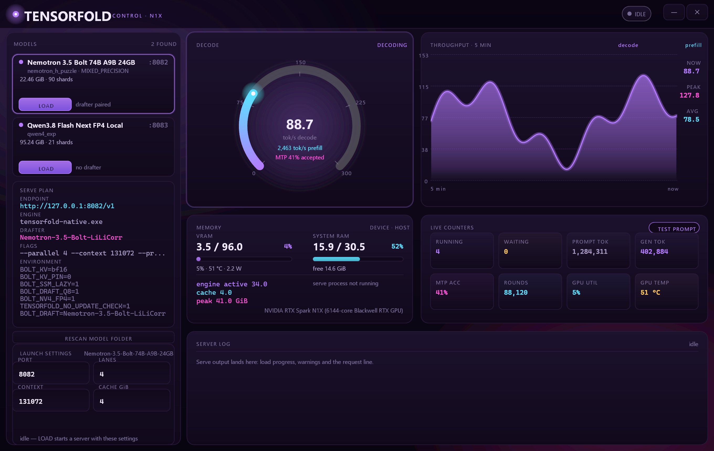
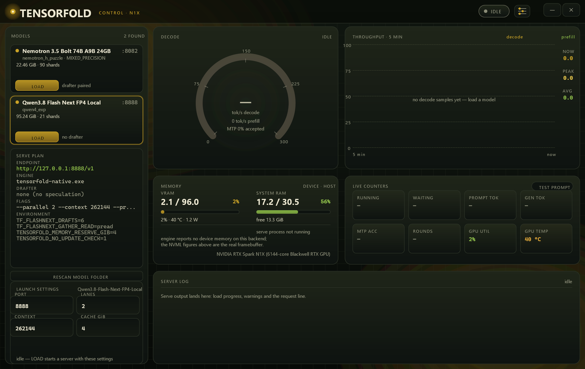
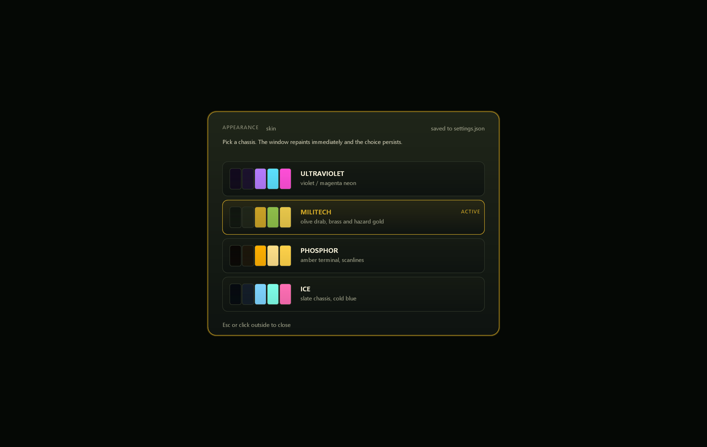

# TensorFold GUI (Windows ARM64)

A single-binary Win32 GUI written in Zig 0.17. The toolchain it expects lives in
`../tools/zig-aarch64-windows-0.17.0/` (not in git — see the repo `.gitignore`).
No Electron, no WebView, no Node, no runtime DLLs beyond what Windows ships.
It discovers local checkpoints, starts or stops `tensorfold-native.exe serve`, and monitors throughput, counters, MTP acceptance, and GPU framebuffer usage. It supports any compatible checkpoint recognized by the pinned TensorFold engine; its built-in launch defaults are specifically tuned for Bolt and `qwen4_exp` (Qwen3.8 Flash-Next), so review settings before launching other model families. The GUI itself does not add model-format or CUDA-kernel support.



## Build

```
gui\build-gui.bat
```

or, from this folder:

```
..\tools\zig-aarch64-windows-0.17.0\zig.exe build -Drelease=true
```

Output: `gui\zig-out\bin\tensorfold-gui.exe` (ReleaseFast).
It finds the repo root by walking up from its own path (or `TENSORFOLD_ROOT`),
so it can live in `zig-out/bin` or anywhere else inside the repo.

`build-gui.bat` also renders the app mark and embeds it: `src/make_icon.zig`
draws the violet orb (the same mark as the header) into `assets/tensorfold.ico`
at 16–256 px, `assets/tensorfold.rc` embeds the icon as a Windows resource, and
`main.zig` loads it for the window and taskbar, so
the taskbar button and the Explorer icon on the exe are the same art. Because the
resource compiler only tracks the `.rc`, the script bumps its timestamp after
regenerating the icon — without that, `zig build` reuses a cached `.res` from an
older icon (and `LoadImage` fails with error 126).

## Run

```
tensorfold-gui.exe                  # window; auto-attaches to a configured port that answers
tensorfold-gui.exe --attach 8082    # monitor a server this GUI did not start
tensorfold-gui.exe --load 0         # load model index 0 on startup
tensorfold-gui.exe --shot out.bmp   # headless render of the dashboard to BMP (dev aid)
tensorfold-gui.exe --skin militech  # start with a skin (also applies to --shot)
tensorfold-gui.exe --settings       # open the appearance overlay on startup
```

The window is fixed-size and frameless (custom chrome, DWM rounded corners and
shadow). `Esc` cancels a field edit, `F5` rescans `models/`, `F2` opens the
appearance overlay, the title bar drags, and the two right-hand buttons
minimise/close.

## Skins

The slider button left of the status chip (or `F2`) opens an appearance overlay
listing the chassis palettes: ULTRAVIOLET (the original violet/magenta),
MILITECH (olive drab with brass and hazard gold, faint 28 px engineering grid),
PHOSPHOR (amber terminal with scanlines) and ICE (slate and cold blue). Picking
one repaints the whole surface — panels, gauge banding, chips, the header mark —
and writes `settings.json` next to the repo root so the choice survives restarts;
`--skin <id>` overrides it for a single run. The palettes are plain colour sets in
`src/theme.zig`, so adding a chassis is a matter of one `Palette` literal plus a
row in `themes`.





## Model rail

- Scans `models/`, reads each checkpoint's `config.json` and optional `hf_quant_config.json`
  for family (`llm_config.model_type`, e.g. `nemotron_h_puzzle`), quantisation and
  shard count, and sums the on-disk size.
- Pairs a drafter folder with the checkpoint it extends (longest shared name
  prefix, e.g. `Nemotron-3.5-Bolt-LiLiCorr`).
- `gui/models.json` holds the per-model launch profile: port, lanes, context,
  prompt-cache GiB, drafter path, environment variables and extra args. It is
  generated on first run and rewritten when you edit a field and press Enter.
  For Bolt the generated profile mirrors `serve-bolt.bat` (`BOLT_KV=bf16`,
  `BOLT_SSM_LAZY=1`, `BOLT_DRAFT_Q8=1`, `BOLT_NV4_FP4=1`, `BOLT_DRAFT=<drafter>`).
  A `qwen4_exp` checkpoint (Qwen3.8 Flash-Next) gets two 262k lanes, a 4 GiB prompt cache and
  the `TF_FLASHNEXT_*` settings. Other checkpoint families get generic defaults and may need
  different context, parallelism, environment variables or arguments. The provided values
  assume substantial available CUDA memory and are not appropriate for every GPU.

**LOAD** spawns `tensorfold-native.exe serve <dir> --name … --host 127.0.0.1
--port … --parallel … --context … --prompt-cache-gib … --dashboard --metrics-open`
with stdout/stderr redirected to `logs/gui-<model>-<ms>.log`. **UNLOAD** terminates
that process. Before spawning, the GUI probes the port; if something already
answers `/health` it refuses to load instead of spending 30 s and then dying on
`AddressInUse`.

An attached server has no child handle, so **UNLOAD** resolves it through the
listening port instead (`GetExtendedTcpTable` in `src/tcp.zig`), checks the image
name is `tensorfold-native` and only then terminates it — an unrelated program on
that port is left alone, and the status line says "detached — that server keeps
running" when it cannot stop it.

## Telemetry

Polled once a second from the server the GUI started (or attached to):

- `/health` — model, lanes, backend, version, warming, engine memory.
- `/stats?poll=1` — decode/prefill tok/s, running/waiting, token totals, MTP
  drafted/accepted, rounds, fill progress.
- `/metrics` — KV-cache occupancy, request counts.

`/stats` only exists when the server runs with `--dashboard`, which the GUI always
passes. GPU figures come from NVML (`nvml.dll`, `nvmlDeviceGetMemoryInfo_v2`)
rather than relying exclusively on the engine's memory fields, which may be zero on the Windows CUDA backend. GPU utilisation, temperature and
power are sampled from NVML too.

Host memory sits beside it in the same panel: physical RAM used/free from
`GlobalMemoryStatusEx` and the serve process's own working set from
`K32GetProcessMemoryInfo`. That matters for TensorFold because a checkpoint can
spill into host memory (PLE tables, prompt-cache disk mode, weights that do not
fit the framebuffer); the RSS line shows what the process is actually holding.

The **TEST PROMPT** button sends a short completion through the same server
so a freshly loaded model shows live counters without leaving the app.

## Files

```
src/main.zig      window, message loop, timers, DPI, DWM, CLI
src/app.zig       layout, painting, hit testing, state machine, polling
src/gfx.zig       GDI+ shapes (rounded panels, gradients, arcs, area charts) + GDI text
src/theme.zig     palette table + live `pal` (ultraviolet / militech / phosphor / ice)
src/settings.zig  persisted skin choice (settings.json)
src/models.zig    model scan + models.json profiles
src/serve.zig     spawn/stop the serve process, log tail
src/stats.zig     HTTP polling and JSON/Prometheus reduction
src/gpu.zig       NVML bindings via LoadLibrary/GetProcAddress
src/hostmem.zig   GlobalMemoryStatusEx + process working set
src/tcp.zig       port→PID lookup (GetExtendedTcpTable) to stop an attached server
src/make_icon.zig renders assets/tensorfold.ico (16–256 px) for the window/taskbar/exe icon
assets/tensorfold.rc embeds that .ico as a Windows resource
src/util.zig      formatting helpers
src/win32.zig     translated Win32/GDI+ headers (see below)
```

`src/win32.zig` is `zig translate-c` output for `windows.h`, `gdiplus.h` and
`dwmapi.h`, pruned of the `__MINGW_NAME_AW`-style token-pasting aliases that
translate-c cannot express (the `W` entry points are used directly). To regenerate:

```
zig translate-c -target aarch64-windows-gnu \
  -I <zig>/lib/libc/include/any-windows-any win32.h > win32.zig
```

then delete the `pub const X = __MINGW_NAME_AW(X);` lines and the
`__MINGW_NAME_AW*` `@compileError` constants, and restore the
`__MINGW_STRING_AW` inline function.

## Validation

The GUI has been exercised with Bolt and Qwen-oriented TensorFold configurations on Windows ARM64. This repository does not ship model weights or automated compatibility tests for every model family. A displayed model entry means the GUI could read its metadata; it does not guarantee the engine can load that checkpoint.

## Known limits

- The engine's own device-memory counters are zeros on the Windows CUDA backend,
  so those rows are informational only; NVML is the source of truth here.
- Unload is `TerminateProcess` — the last buffered log lines may be lost.
- One server at a time: loading a second model unloads the first (the GUI stops
  the running process before spawning).
- Access-log lines (`GET /health`, `/metrics`, `/stats`) are filtered out of the
  log panel so load progress and warnings stay visible.
- Images/video are unaffected — this is a control surface, not a chat client.
